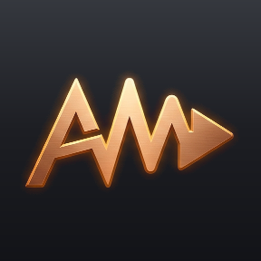
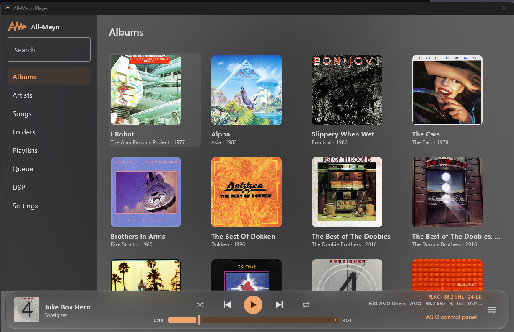
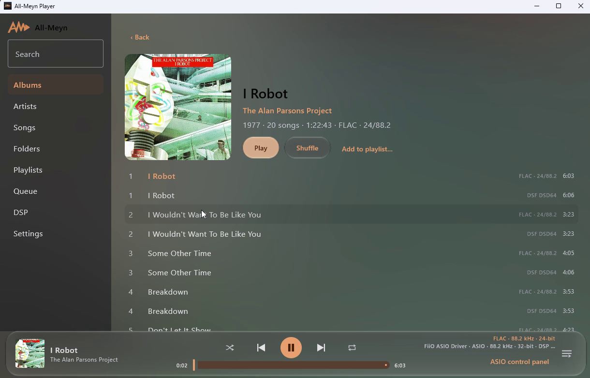
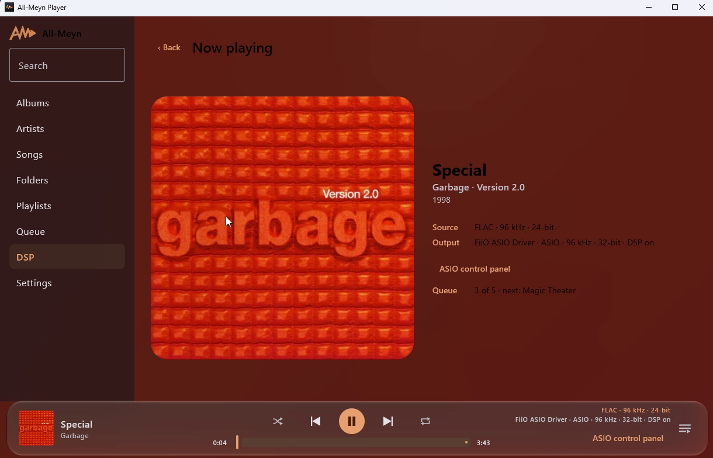
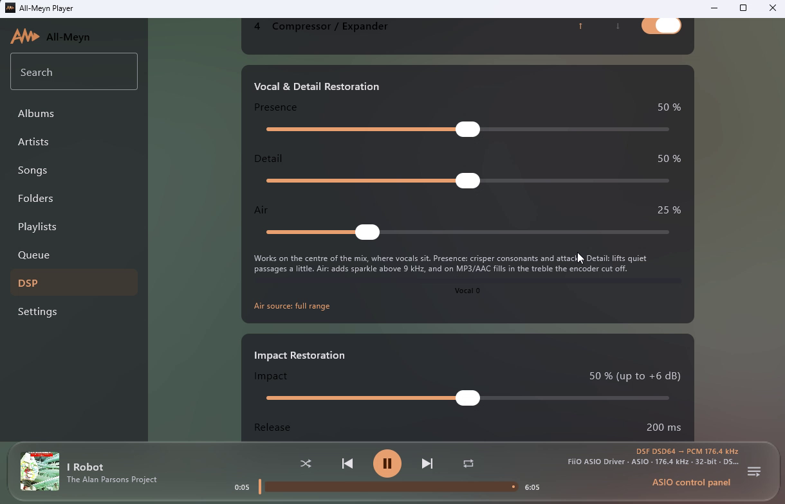
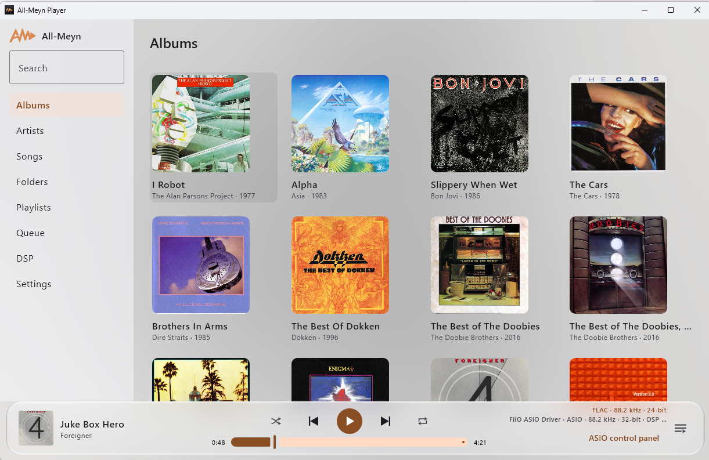
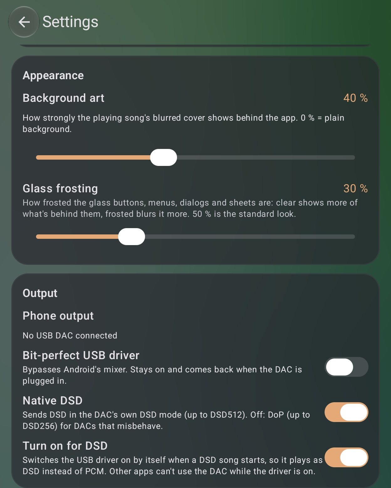

<p align="center">
  
</p>

<h1 align="center">All-Meyn Player</h1>

<p align="center">
  A bit-perfect music player for Android and Windows, built for USB DACs and native DSD,<br>
  with a restoration DSP chain, headphone EQ, and a plugin tap on every decoded buffer.
</p>

<p align="center">
  <a href="https://github.com/All-Meyn/All-Meyn-Music-Player/releases/latest"></a>
  
  
</p>

<p align="center">
  
</p>

## Download
Get the latest **Android APK** and **Windows installer (MSI)** from
[Releases](https://github.com/All-Meyn/All-Meyn-Music-Player/releases/latest). Each release lists
SHA-256 checksums in `SHA256SUMS.txt`.

## Features
**Playback**
- Lossless and high-res: FLAC, ALAC, WAV/AIFF, APE, WavPack, plus MP3, AAC, Opus, Vorbis and more.
- DSD (DSF/DFF, DSD64–DSD512): native DSD or DoP to a DSD-capable DAC, otherwise high-rate PCM.
- **Android:** All-Meyn's own USB audio driver bypasses Android's mixer for bit-perfect output (native DSD up to DSD512, DoP up to DSD256). Without it, it uses Android 14+'s bit-perfect mixer where the DAC supports it.
- **Windows:** WASAPI exclusive (bit-perfect at the song's own rate), WASAPI shared, and ASIO (including native DSD and each driver's control panel).
- Gapless playback, shuffle and repeat, playlists, ReplayGain (track or album), and a queue that's remembered.

**Sound**
- Restoration DSP chain: Vocal & Detail Restoration, Compressor/Expander, Bass Restoration and Impact Restoration, with live meters. Off means untouched, bit-perfect audio.
- Headphone EQ: a parametric EQ that imports AutoEq / EqualizerAPO files, plus a convolution EQ for impulse responses (WAV) and GraphicEQ.
- About 12,600 built-in headphone presets from [OPRA](https://github.com/opra-project/OPRA) (search your model and tap).
- Each output (USB DAC, Bluetooth, ASIO driver…) remembers its own EQ.

**Look**
- Liquid Glass interface, with the playing song's blurred cover behind it and adjustable glass frosting.
- On Windows, a light theme that follows Windows' setting, media keys and drag-to-reorder.

## Screenshots
### Windows
| Album | Now playing |
|---|---|
|  |  |
| **DSP** | **Light theme** |
|  |  |

### Android


## Writing a plugin (Android)
Every decoded buffer is handed to your plugins before it reaches the output.

```kotlin
class MyPlugin : AudioCapturePlugin {
    override val name = "My plugin"
    override fun onConfigure(format: PcmFormat) { /* allocate ring buffer for this format */ }
    override fun onBuffer(buffer: ByteBuffer, presentationTimeUs: Long) {
        buffer.order(ByteOrder.LITTLE_ENDIAN)
        // copy buffer[position..limit) into your ring buffer; process on your own thread
    }
}
```
Register it in `AllMeynApp.onCreate()` with `PluginHost.register(MyPlugin())`.

`onBuffer` runs on the playback thread: no blocking, allocation or I/O. Audio arrives in the
decoder's native format (16-bit, 24-bit packed, 32-bit or float), before resampling.
`plugin/LevelMeterPlugin.kt` is a working example.

## Format support
Through Media3 (+ FFmpeg extension): MP3, AAC, FLAC, ALAC, Opus, Vorbis, WAV/AIFF, AC-3/E-AC-3,
DTS, TrueHD in MP3, MP4/M4A, FLAC, Ogg, WAV, Matroska/WebM, ADTS containers.

Through All-Meyn's own decoders (`app/src/main/cpp/decoder`):
- **DSF / DFF (DSD64–DSD512):** native DSD or DoP (bit-exact) to a DSD-capable DAC, otherwise
  converted to 176.4 kHz (or 192 kHz) PCM. DST-compressed DFF isn't supported.
- **APE (Monkey's Audio) and WavPack:** lossless, 16/24-bit and float, via a minimal FFmpeg build
  (LGPL); see *Build*.

The Windows app decodes with its own FFmpeg build (FLAC, ALAC, MP3, AAC, Vorbis, Opus, APE,
WavPack, PCM) and the same DSD decoder.

**Not yet supported:** WMA, Musepack, TAK, DST-compressed DFF.

## Repository layout
| Path | What's there |
|---|---|
| `app/` | Android app: Kotlin + Jetpack Compose, AndroidX Media3, USB driver, DSP and decoders in C/C++ (`app/src/main/cpp`) |
| `desktop/` | Windows app: Kotlin + Compose Multiplatform, native engine `allmeyn_desktop.dll` (WASAPI, ASIO), MSI installer |
| `native-tests/` | Host tests for the shared C/C++ (DSP, convolver, decoders) |
| `branding/` | Logo sources and the icon generator |
| `scripts/` | FFmpeg builds, OPRA preset converter |

## Build
CI builds both apps on every push (Actions tab; artifacts `all-meyn-player-debug` and the Windows
MSI) and runs the native host tests, JVM unit tests and emulator tests. Pushing a `v*` tag that
matches `version.txt` publishes a signed release.

**Android:** open in Android Studio, or `./gradlew assembleDebug`. For APE/WavPack, first build
the minimal FFmpeg once (Linux/macOS, needs the NDK and `make`):

    scripts/build-ffmpeg.sh $ANDROID_HOME/ndk/27.0.12077973

Without it the app still builds and plays everything else.

**Windows:** `./gradlew -p desktop packageMsi` (the native engine is cross-compiled with MinGW-w64;
see `desktop/` and the Windows workflow).

## Credits and licenses
- Headphone EQ presets: [OPRA](https://github.com/opra-project/OPRA), data under
  [CC BY-SA 4.0](https://creativecommons.org/licenses/by-sa/4.0/); each preset's creator is shown in the app.
- [Liquid Glass](https://github.com/shayann07/liquidglass) for Compose (Apache 2.0).
- ASIO is a trademark and software of Steinberg Media Technologies GmbH.
- The FFmpeg decoder dependency is GPL-3.0, so distributing this app means releasing it under a
  GPL-compatible license.

Album covers in the screenshots belong to their respective owners.
